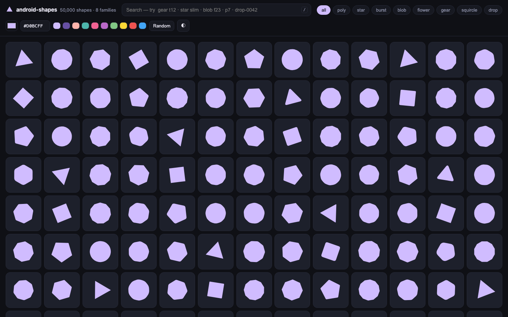
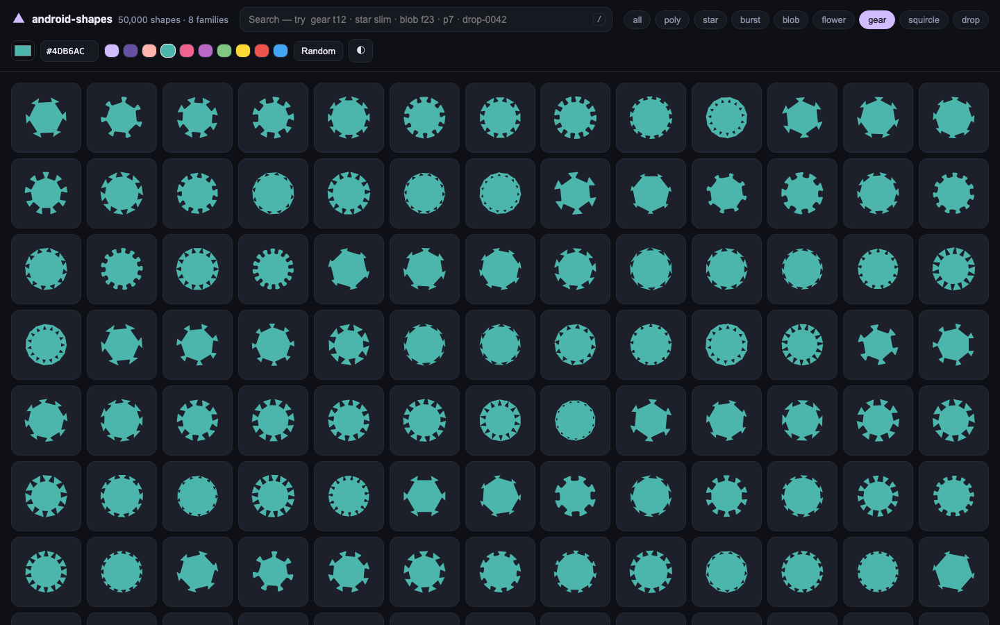

# android-shapes

**Live site → https://kavya-24.github.io/Android-Shapes/site/**

| | |
|---|---|
|  |  |

_50,000 shapes · hex color tray · light/dark preview — every tile is a vector, no images stored_

A generated library of **50,000 decorative vector shapes** (8 families × 6,250 variants) with a searchable, colorable gallery hosted on GitHub Pages. Every shape can be copied as:

- **SVG** (any color)
- **Android VectorDrawable XML** (`<vector>` + `pathData`)
- **Jetpack Compose** `PathParser().parsePathString(...).toPath()` snippet
- **PNG** (512px download)
- raw **path data**

## Site

Static, no build step. `site/` + `data/` are served straight from GitHub Pages (repo Settings → Pages → Deploy from branch / or the included GitHub Actions workflow).

```
node scripts/generate.mjs 50000   # regenerate data (any multiple of 8)
node scripts/serve.mjs 8177       # local preview → http://localhost:8177/site/
```

Search works client-side over `data/manifest.json` (id + tags). Shapes load lazily from 250-shape shards, so the page stays fast even with tens of thousands of shapes.

The page also reads shareable URL params: [`?f=gear&c=%234DB6AC`](https://kavya-24.github.io/Android-Shapes/site/?f=gear&c=%234DB6AC) pins a family (`f=`) and hex color (`c=`); `q=` pre-fills a search.

## Families

| Family | Variant axes | Tags |
|---|---|---|
| `poly` | vertices 3–12, corner rounding, rotation | `v6` `soft` `r3` |
| `star` | points 3–12, inner radius, tip roundness, rotation | `p5` `slim` `round` |
| `burst` | jagged stars, per-vertex seeded jitter | `j9` `wild` |
| `blob` | harmonic frequencies × amplitudes × phases | `f23` `wavy` |
| `flower` | petals 4–12, petal depth, rotation | `k7` `deep` |
| `gear` | teeth 6–15, tooth height/width, rounding | `t12` `tall` |
| `squircle` | superellipse exponent 2.4–6.8, aspect | `e4` `egg` |
| `drop` | teardrop / leaf / crescent / shield × curvature | `teardrop` `slim` |

All shapes are deterministic (seeded PRNG) and deduplicated by exact path data. Search examples: `gear t12`, `star slim round`, `squircle e4 egg`.

## MCP server (optional)

`mcp/server.mjs` exposes the same index to MCP clients (Claude Desktop, opencode, …):

```
npm i fastmcp zod
node mcp/server.mjs
```

Tools: `search_shapes(query, limit)` → matching shape ids; `get_shape(id)` → path data + SVG + Android XML + Compose snippet for one shape.
